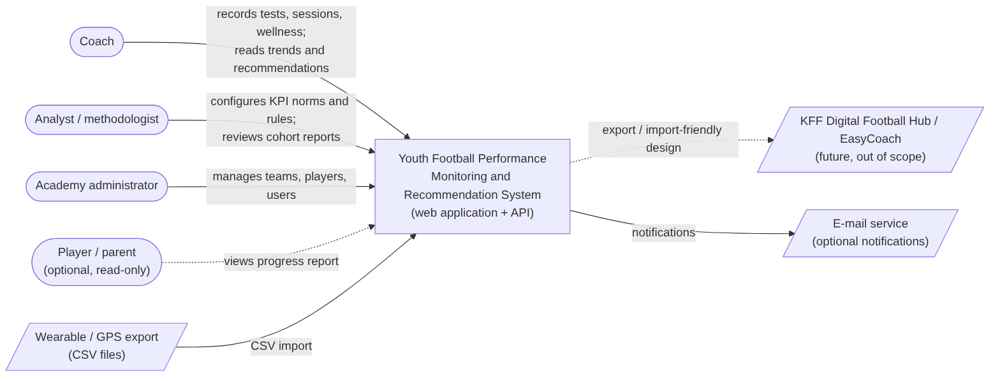
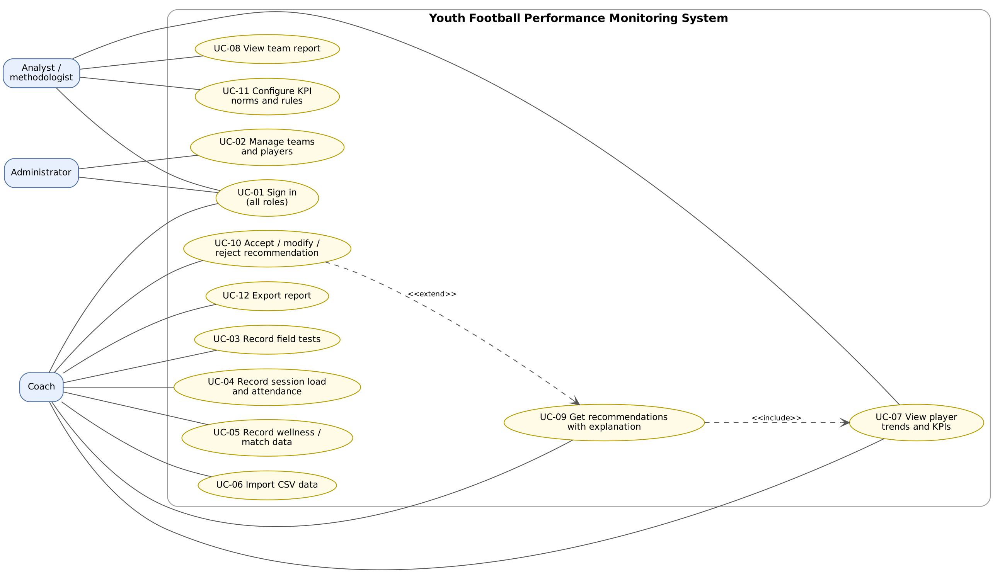
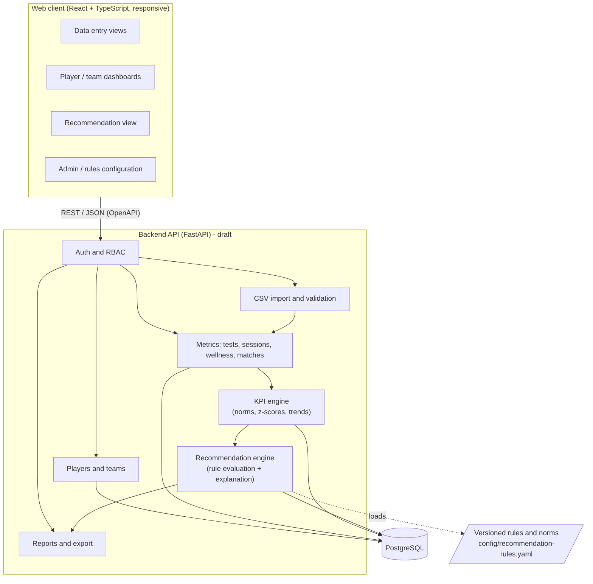

# 7. Architecture and diagrams (draft v0.1)

Editable sources are in [`diagrams/src`](../diagrams/src) (Mermaid `.mmd`, Graphviz `.dot`); rendered SVG/PNG in [`diagrams/exports`](../diagrams/exports).
Regenerate: `mmdc -i diagrams/src/<file>.mmd -o diagrams/exports/<file>.svg` / `dot -Tsvg diagrams/src/02-use-cases.dot -o diagrams/exports/02-use-cases.svg`.

| # | Diagram | Source | Export |
|---|---|---|---|
| 1 | System context | [01-system-context.mmd](../diagrams/src/01-system-context.mmd) | [svg](../diagrams/exports/01-system-context.svg) / [png](../diagrams/exports/01-system-context.png) |
| 2 | Use cases | [02-use-cases.dot](../diagrams/src/02-use-cases.dot) | [svg](../diagrams/exports/02-use-cases.svg) / [png](../diagrams/exports/02-use-cases.png) |
| 3 | Components (draft) | [03-components.mmd](../diagrams/src/03-components.mmd) | [svg](../diagrams/exports/03-components.svg) / [png](../diagrams/exports/03-components.png) |
| 4 | Data model (draft ER) | [04-data-model.mmd](../diagrams/src/04-data-model.mmd) | [svg](../diagrams/exports/04-data-model.svg) / [png](../diagrams/exports/04-data-model.png) |
| 5 | Sequence: recommendation | [05-sequence-recommendation.mmd](../diagrams/src/05-sequence-recommendation.mmd) | [svg](../diagrams/exports/05-sequence-recommendation.svg) / [png](../diagrams/exports/05-sequence-recommendation.png) |

## 7.1 Architectural description
Layered, modular monolith (appropriate for a two-person team): React client -> REST/JSON API (FastAPI) -> domain modules -> PostgreSQL.
* **Auth/RBAC** guards every endpoint (FR-01, NFR-02).
* **Metrics** stores tests, session loads, wellness and match records; **Import** validates CSV and feeds Metrics (FR-09, FR-17).
* **KPI engine** computes values, cohort z-scores and trends (FR-10); pure functions, no web dependencies, unit-tested (NFR-07).
* **Recommendation engine** evaluates a versioned rule set ([config/recommendation-rules.yaml](../config/recommendation-rules.yaml)) and returns recommendations with rule ID, inputs, threshold and rationale (FR-13, NFR-06, ADR-0002).
* **Reports** render screen/CSV/PDF output (FR-12, FR-16).

## 7.2 Requirement alignment
| Requirement | Component | Scenario / diagram |
|---|---|---|
| FR-01, FR-02, FR-03 | Auth, Players and teams | UC-01, UC-02 |
| FR-05..FR-08 | Metrics | UC-03..UC-05 |
| FR-09, FR-17 | Import | UC-06 |
| FR-10, FR-11, FR-12 | KPI engine, Reports | UC-07, UC-08 |
| FR-13, FR-14, FR-15 | Recommendation engine | UC-09..UC-11, sequence diagram |
| FR-16 | Reports | UC-12 |

## 7.3 Known limitations of the draft
Component boundaries and the ER model will be refined when interview results arrive; the rule-set storage (file vs. DB table) is open (FR-15 requires versioning in DB). Deployment diagram is planned (DIP-19).
